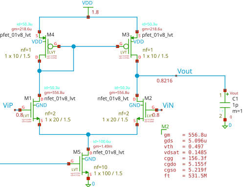

Consider a 5T OTA as shown in @fig-ota-init. The characteristics of the OTA are listed in @tbl-ota-init.

::: {#tbl-ota-init}
| Parameter    | Value        |
|--------------|--------------|
| Gain         | 75 V/V       |
| UGBW         | 81 MHz       |
| M2: $I_d$    | 50 µA        |
| M2: $g_m$    | 557 µS       |
| M2: $V_{ov}$ | 148 mV       |
| M2: W/L      | 20 µm/1.5 µm |

: OTA Characteristics
:::

{#fig-ota-init width="60%"}

::: callout-note
A step-by-step design flow for a 5T OTA is presented in this article:\
[[Design of a Simple OTA](/designflow/designflow1.qmd)]{.content-visible when-format="html"}[[Design of a Simple OTA](https://research.acc-designs.com/designflow/designflow1.html)]{.content-visible when-format="pdf"}
:::

What if the bias current of the tail transistor is changed? How would the performance of the OTA be affected? What if we want to increase the bandwidth or reduce the power consumption of the OTA? In this article, we will discuss the relationship between the biasing and sizing of the transistors in a 5T OTA and its performance.

From square-law theory, the drain current of an NMOS transistor in saturation is given by:

$$
I_d = \frac{1}{2} \mu_n C_{ox} \frac{W}{L} (V_{gs} - V_{th})^2
$$ {#eq-id1}

We know that the small-signal transconductance of a MOSFET is defined as the derivative of the drain current with respect to the gate-source voltage:

$$
g_m=\frac{\partial I_d}{\partial V_{gs}}=\mu_n C_{ox} \frac{W}{L} V_{ov}
$$ {#eq-gm1}

The $V_{ov}$ is the overdrive voltage of the transistor. The overdrive voltage is defined as:

$$
V_{ov}=V_{gs}-V_{th}
$$ {#eq-vov}

where $V_{th}$ is the threshold voltage of the transistor.

The other way to express the transconductance is in terms of the drain current and overdrive voltage:

$$
g_m=\frac{2 I_d}{V_{ov}}
$$ {#eq-gm2}

Furthermore, in terms of the drain current and the aspect ratio of the transistor, the transconductance can be expressed as:

$$
g_m=\sqrt{2 \mu_n C_{ox} \frac{W}{L} I_d}
$$ {#eq-gm3}

All of these equations show the transconductance of a MOSFET. Note that parameters $V_{ov}$, $W/L$, and $I_d$ are not independent of each other. For example, if we change the bias current of the transistor, the overdrive voltage will also change. But each of the $g_m$ equations gives us a different perspective on how the transconductance is affected by the biasing and sizing of the transistor.

Note that the square-law model is only an estimation. In sub-micron technologies, effects such as velocity saturation and mobility degradation reduce the factor 2 in @eq-gm2 to about 1.5. For example, for M2 in @tbl-ota-init, $g_m V_{ov}/I_d \approx 1.65$ instead of 2. Therefore, the equations are used here to understand the trends rather than to predict exact values.

Suppose in @fig-ota-init, the bias current of the input differential pair transistor M2 is changed 10% from 50 µA to 55 µA. What will be the new transconductance of the transistor? And how will the performance of the OTA be affected?

$$
\frac{\Delta I_d}{I_d}=10\% \implies \frac{\Delta g_m}{g_m}=?
$$ {#eq-Idchange}

Since the size of the transistor remains unchanged, from @eq-gm3, we have:

$$
\frac{\partial g_m}{\partial I_d} = \frac{1}{2} \sqrt{\frac{2 \mu_n C_{ox} W/L}{I_d}} = \frac{g_m}{2 I_d}
$$ {#eq-dgm-did}

For small changes in the drain current, we can approximate the change in transconductance as:

$$
\Delta g_m \approx \frac{\partial g_m}{\partial I_d} \Delta I_d = \frac{g_m}{2 I_d} \Delta I_d
$$ {#eq-dgm-approx}

$$
\frac{\Delta g_m}{g_m} \approx \frac{1}{2} \frac{\Delta I_d}{I_d} = \frac{1}{2} \cdot 10\% = 5\%
$$ {#eq-gmchange}

This shows that a 10% increase in the bias current of the transistor results in only a 5% increase in its transconductance. This is because the transconductance is proportional to the square root of the drain current, as shown in @eq-gm3.

Now, let's see what happens if we change the size of the transistor so that the overdrive voltage remains constant when the bias current is changed 10% from 50 µA to 55 µA. From @eq-gm2, we have:

$$
g_m = \frac{2 I_d}{V_{ov}} \implies \frac{\Delta g_m}{g_m} = \frac{\Delta I_d}{I_d}
$$ {#eq-gmchange-vov}

In contrast, if we change the size of the transistor to keep the overdrive voltage constant, a 10% increase in the bias current results in a 10% increase in its transconductance. This is because the transconductance is directly proportional to the drain current when the overdrive voltage is constant, as shown in @eq-gm2.

Another case is when we change the size of the transistor while the bias current remains constant. In this case, the overdrive voltage will change. Hence, from @eq-gm3, we have:

$$
g_m = \sqrt{2 \mu_n C_{ox} \frac{W}{L} I_d} \implies \frac{\Delta g_m}{g_m} = \frac{1}{2} \frac{\Delta (W/L)}{(W/L)}
$$ {#eq-gmchange-wl-id}

And in case of changing the size of the transistor when the overdrive voltage is constant, using @eq-gm1 we have:

$$
g_m = \mu_n C_{ox} \frac{W}{L} V_{ov} \implies \frac{\Delta g_m}{g_m} = \frac{\Delta (W/L)}{(W/L)}
$$ {#eq-gmchange-wl-vov}

It can be concluded that the sensitivity of the transconductance to the biasing and sizing of the transistor depends on the condition of the other parameters. If we change the bias current while keeping the size of the transistor constant, the transconductance is less sensitive to the change in bias current. However, if we change the size of the transistor while keeping the overdrive voltage constant, the transconductance is more sensitive to the change in size.

We know that the UGBW of an OTA is given by:

$$
UGBW = \frac{g_m}{2 \pi C_L}
$$ {#eq-ugbw}

How to increase the UGBW of the OTA while keeping the power consumption constant? The answer is to increase the transconductance of the input differential pair transistor while keeping the bias current constant. This can be achieved by increasing the size of the transistor while keeping the current constant, which will reduce the overdrive voltage of the transistor. However, this will also increase the input capacitance of the OTA. Therefore, there is a trade-off between the UGBW and the input capacitance of the OTA. The designer should consider the requirements of the application and choose the appropriate sizing and biasing of the transistors in the OTA to achieve the desired performance.

Furthermore, the designer should also consider that the square-law based equations are only valid in the saturation region of the MOSFET. If the overdrive voltage becomes too small, about 80 mV, the MOSFET enters the subthreshold region, and the square-law model no longer accurately describes its behavior. In this region, the current depends exponentially on the gate voltage, and the transconductance will not follow the previously discussed relationships. There, $g_m/I_d$ saturates at its maximum value of about $1/(n V_T)$, where $n$ is the subthreshold slope factor and $V_T$ is the thermal voltage. Hence, increasing the size of the transistor further at a constant current no longer increases $g_m$, and the UGBW does not improve, while the input capacitance of the OTA keeps increasing.

@tbl-ota-sim shows the simulation results of the OTA when bias current and transistor sizes are varied ±10% around the nominal values, illustrating the impact on transconductance, UGBW, and gain. It can be observed that increasing the bias current or the transistor size generally increases the transconductance and UGBW, while the gain shows a less pronounced variation (why?). 

::: {#tbl-ota-sim}
| $I_d$ (µA) | $V_{ov}$ (mV) | $W/L$ (µm/µm) | $g_m$ (µS) | UGBW (MHz) | Gain (V/V) |
|------------|---------------|---------------|------------|------------|------------|
| 50         | 148           | 20/1.5        | 557        | 81         | 75         |
| 55         | 155           | 20/1.5        | 588        | 86         | 74         |
| 45         | 142           | 20/1.5        | 524        | 77         | 76         |
| 50         | 143           | 22/1.5        | 580        | 84         | 76         |
| 50         | 155           | 18/1.5        | 532        | 78         | 73         |

: Simulation Results of the OTA shown in @fig-ota-init for different bias currents and transistor sizes.
:::

