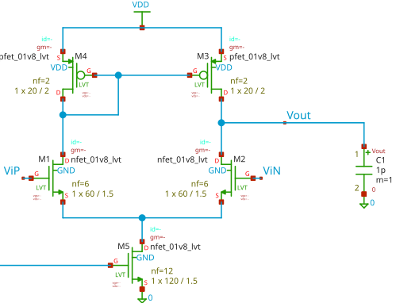
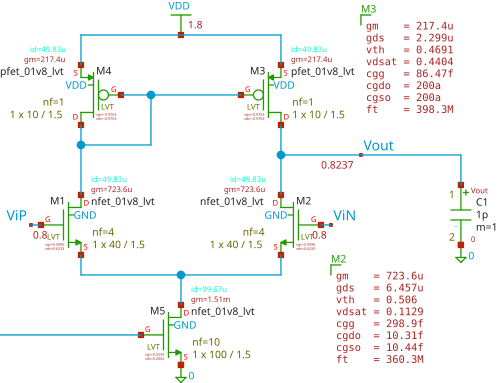
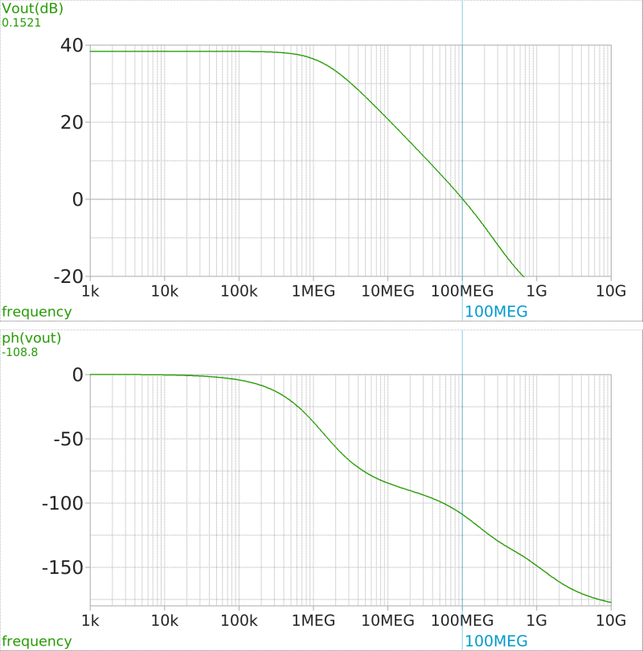

Amplifiers are among the most important blocks in analog IC design, as they are used in a wide range of analog and mixed-signal circuits, including active filters, integrators, sensor interfaces, sample-and-hold circuits, and data converters. When combined with an appropriate feedback network, an op-amp can perform mathematical operations, amplify small signals, and provide accurate signal conditioning. Its performance therefore has a significant impact on the overall performance of the systems in which it is used.

Several parameters must be considered when designing an op-amp. **DC open-loop gain** determines how accurately the amplifier can operate in a feedback configuration. **Unity-gain bandwidth (UGBW)** indicates the frequency at which the open-loop gain falls to unity, while **phase margin** provides an indication of closed-loop stability. **Slew rate** determines the maximum rate of change of the output voltage, and **settling time** specifies how quickly the output reaches and remains within a desired error range after an input transition. Other important parameters include power consumption, input-referred noise, input offset voltage, input common-mode range, output voltage swing, common-mode rejection ratio (CMRR), power-supply rejection ratio (PSRR), and silicon area. The relative importance of these parameters depends on the intended application and its requirements.

The general design flow for an analog circuit block is shown in @fig-flow.

```{mermaid}
%%| label: fig-flow
%%| fig-cap: Analog block design flow.
%%| fig-height: 3
flowchart TD
A[Define design specifications] --> B[Select circuit topology]
B --> C[Perform hand calculations]
C --> D[Choose initial transistor dimensions and bias]
D --> E[Simulation]
E --> F[Modification]
F --> E 
```

As a practical example, consider the design of a **five-transistor operational transconductance amplifier (5T OTA)** in a nominal 1.8 V CMOS process. This topology consists of an NMOS differential input pair, a PMOS current-mirror active load, and an NMOS tail-current source. It is an attractive starting point because of its simple structure, low transistor count, and relatively low power consumption. However, its single-stage architecture and limited output-voltage headroom constrain its gain, output swing, and driving capability. The target specifications for an illustrative design could be:

1.  Supply voltage: 1.8 V

2.  Load capacitance: 1 pF

3.  DC gain: at least 40 dB

4.  Unity-gain bandwidth: at least 100 MHz

5.  Power consumption: \< 200 $\mu W$

The first step is to select the CMOS process and its PDK. The PDK provides the transistor models, design rules, and other technology-specific information required for realistic circuit design.

Important parameters include transistor threshold voltages, current characteristics, output resistance, parasitic capacitances, and available channel lengths. These parameters influence the transistor dimensions, bias conditions, achievable gain, and bandwidth.

In a preliminary educational design, simplified MOSFET equations can be used to estimate the operating point and initial dimensions. However, these equations are based on approximations and cannot fully represent the behavior of actual CMOS transistors. The final transistor sizing must therefore be refined using the selected PDK models.

This article uses the open-source SkyWater SKY130 PDK because Ngspice device models are available, and Xschem can be used for schematic capture and simulation. Device models and parameters for the SKY130 PDK are available on the [SKY130 Device Details page](https://skywater-pdk.readthedocs.io/en/main/rules/device-details.html).

# Topology

Once the specifications and technology are known, an appropriate amplifier topology can be selected.

The 5T OTA is a useful example because it consists of only five transistors: an NMOS differential input pair, a PMOS current-mirror active load, and an NMOS tail-current source, as shown in @fig-circuit. Its small transistor count makes the circuit suitable for illustrating fundamental analog IC design principles.

{#fig-circuit}

Note that the device sizes in @fig-circuit have not yet been determined; the figure shows only the topology. According to the SKY130 PDK documentation, the threshold voltage of MOS devices depends on W and L for both typical and LVT types. Thus, after designing the circuit and obtaining rough estimates of the device sizes, we can determine the threshold voltages and estimate the operating points. This design uses LVT devices.

# Hand calculation

The next step is to translate the specifications into electrical requirements.

For example, the unity-gain bandwidth determines the approximate minimum transconductance required of the input transistors.

$$
2\pi f_u=\frac{g_{mN}}{C_L}
$$ {#eq-gbw}

where $g_{mN}$ is the transconductance of the NMOS differential pair. The actual load capacitance is the sum of the load capacitor and the drain capacitances of M~2~ and M~3~, $C_L + C_{d2} + C_{d3}$. Since the transistor sizes are still unknown, assume a load capacitance that is 10% higher than the specified value, or 1.1 pF. The minimum $g_m$ is then

$$
g_{mN} \approx 2\pi f_uC_{L\mathrm{total}}\approx 700\mu \mho
$$ {#eq-mingm}

The other constraint is the amplifier's DC gain, which must be greater than 40 dB, or 100. The intrinsic gain of the input differential pair must therefore be greater than 100. To meet this requirement, we need to choose appropriate sizes for the NMOS differential pair. In the SKY130 process, the minimum channel length is 0.15 um. At this minimum channel length, the maximum achievable intrinsic gain is about 15, as shown in @fig-gain_gm-1. According to the square-law MOSFET model:

$$
g_m=\frac{2I_d}{V_{ov}},\quad 
\frac{1}{g_{ds}}\approx \frac{1}{\lambda I_d}\implies
\frac{g_m}{g_{ds}}\approx \frac{2}{\lambda V_{ov}} 
$$ {#eq-int-gain}

This shows that, for a given $V_{ov}$, a MOSFET's intrinsic gain depends on $\lambda$ and, consequently, on $L$, while being almost independent of $W$. Increasing $L$ decreases $\lambda$ and therefore increases intrinsic gain. @fig-gain_gm-2 shows the intrinsic gain for $L=1.5\mu m$. The maximum intrinsic gain is about 110, so we begin the design with $L=1.5\mu m$.

```{python}
#| echo: false
#| label: fig-gain_gm
#| fig-cap: "NMOS intrinsic gain $g_m/g_{ds}$ and $g_m$ versus overdrive voltage $V_{ov}$."
#| fig-subcap:
#|  - $W/L=10\mu /0.15\mu$
#|  - $W/L=100\mu /1.5\mu$
#| layout-ncol: 2
#| 

%run "designflow1/gain_ov.py"
```

According to the square-law MOSFET model, $g_m=2I_d/V_{ov}$. In submicron technologies, the coefficient is roughly 1.2 to 1.5. We can calculate the overdrive voltage of the input differential pair to achieve the required $g_m$ shown in @eq-mingm. Given a maximum power consumption of 200 uW and a supply voltage of 1.8 V, let us choose a tail current of 100 uA, corresponding to $I_d=50\mu A$. This determines the overdrive voltage $V_{ov}$.

$$
V_{ov}\approx\frac{1.5}{g_{mN}/I_d}\approx100mV
$$ {#eq-vod}

Note that an overdrive voltage below approximately 80 mV may push the MOSFET into the subthreshold region, where the device's gain bandwidth drops significantly.

The OTA gain must be at least 40 dB, or 100.

$$
Gain=\frac{g_{mN}}{g_{ds2}+g_{ds3}}
$$ {#eq-gain}

According to @fig-gain_gm-2, $g_{mN}/g_{ds2}\approx110$. To achieve a gain of 100, $g_{ds3}$ must be roughly $g_{ds2}/10$, which is quite small. Achieving this requires the PMOS active-load devices M~3~ and M~4~ to have very large widths and lengths, resulting in very large gate capacitances. This moves the active load pole and zero to lower frequencies, which cannot be ignored. Therefore, we must consider the effect of the active load on the OTA's frequency response. The active load introduces a pole and a zero in the OTA's frequency response, which can be approximated as follows:

$$
\omega_{p2}\approx\frac{g_{mP}}{C_{g3}+C_{g4}},\quad
\omega_{z1}\approx2\omega_{p2}  
$$ {#eq-pole-zero}

where $C_{g3}$ and $C_{g4}$ are the gate capacitances of M~3~ and M~4~, respectively. The zero is located at approximately twice the frequency of the pole. If the P2 pole is in the vicinity of the gain-bandwidth product, it will degrade the unity-gain bandwidth. We will see the effect of the active load on the OTA's frequency response in the simulation section.

According to @fig-gain_gm-2, for Vov=100mV, the gm is 1m for W/L=100/1.5. Therefore, we can choose W/L=40/1.5 for the input differential pair to achieve gm=700u. The tail current source can be designed with W/L=100/1.5 to achieve a current of 100uA. The PMOS active load can be designed with W/L=10/1.5. The OTA schematic, including the transistor sizes and operating points, is shown below.

{#fig-OTA2 width=100%}

The branch currents of the OTA are 50 uA, and the overdrive voltages of the input differential pair are roughly 100 mV. The active-load PMOS transistors have overdrive voltages of 440 mV, which are much higher than those of the input pair. This is expected because the active load's W/L ratio is set to 10/1.5 so that its pole is at a higher frequency than the unity-gain bandwidth.

# Simulation

After hand calculations, sizing, and biasing, the next step is to simulate the circuit to verify its performance. The OTA was simulated using Ngspice with the SKY130 PDK models. The simulation results for the frequency response are shown below.   

{#fig-freq-response}

The unity-gain bandwidth is approximately 100 MHz. The DC gain is about 38 dB, or 80, which is slightly below the target of 40 dB. The phase margin is about 71 degrees, which indicates good stability. The power consumption is about 180 uW, which is below the target of 200 uW.
